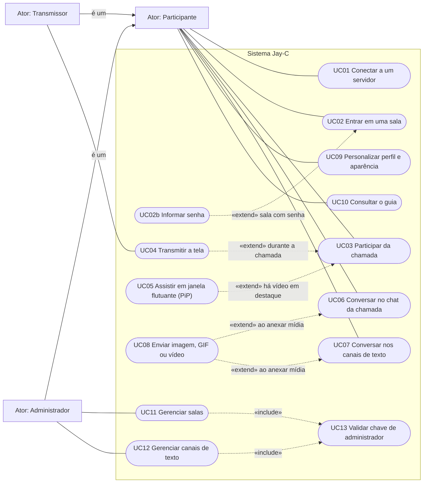
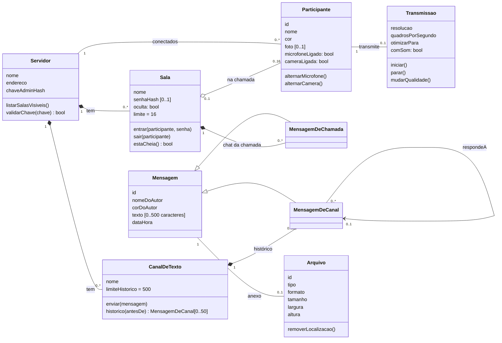
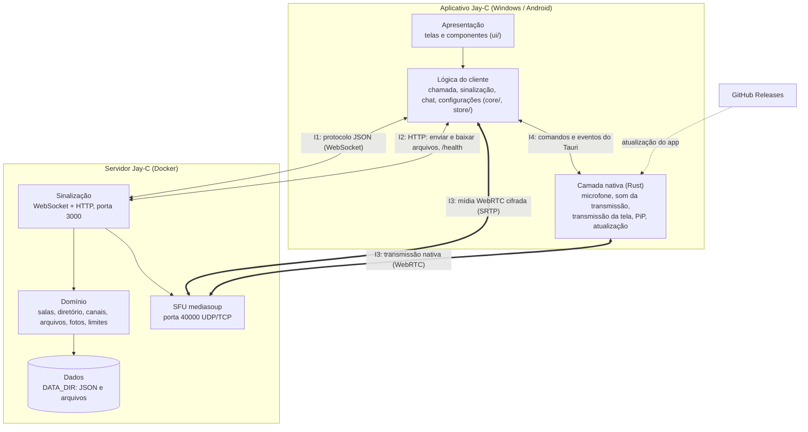
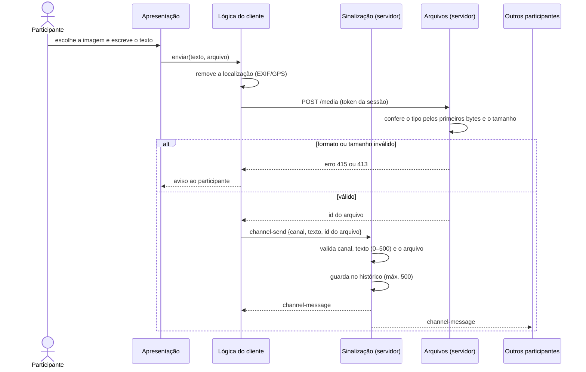
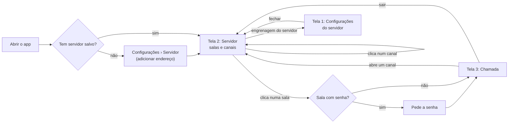
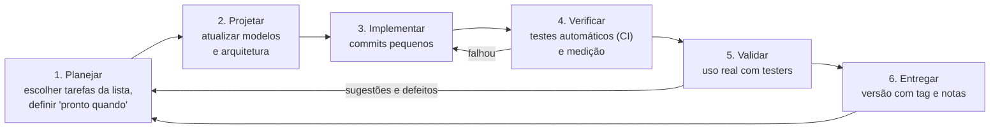
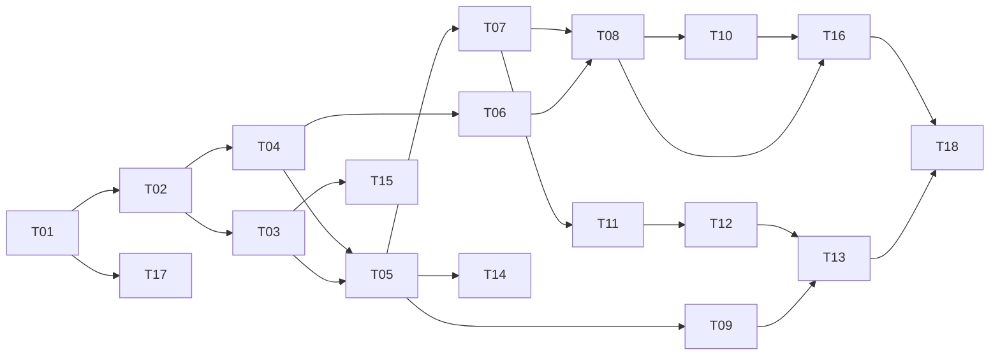
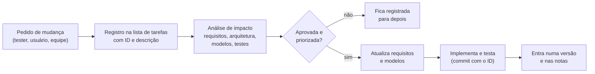

# Jay-C — Dossiê técnico

> Rascunho completo do PDF final (seções 4.1 a 4.8), para revisão da equipe.
> Trechos marcados **[preencher]** dependem da equipe.

---

## Capa

- **Instituição:** Universidade Estadual de Ponta Grossa (UEPG)
- **Disciplina:** Fundamentos de Engenharia de Software
- **Título:** Jay-C — comunicação por voz, vídeo e tela, simples, gratuita e local
- **Turma:** 1º Ano A
- **Integrantes:** Augusto do Amarante, Cristofer Dvorecky Oliveira, Guilherme Perpétuo, Henrique Augusto, Mateus Valenga
- **Data:** 19/11/2026

## Sumário

**[4.1 Identificação e contextualização](#41-identificação-e-contextualização)**
1. [Introdução](#1-introdução)
2. [Problema](#2-problema)
3. [Público-alvo](#3-público-alvo)
4. [Objetivos](#4-objetivos)
5. [Limites do sistema](#5-limites-do-sistema)
6. [Justificativa](#6-justificativa)

**[4.2 Stakeholders e levantamento de requisitos](#42-stakeholders-e-levantamento-de-requisitos)**
7. [Stakeholders](#7-stakeholders)
8. [Levantamento de requisitos](#8-levantamento-de-requisitos)
9. [Requisitos funcionais](#9-requisitos-funcionais)
10. [Requisitos não funcionais](#10-requisitos-não-funcionais)
11. [Regras de negócio](#11-regras-de-negócio)
12. [Conflitos, ambiguidades e restrições](#12-conflitos-ambiguidades-e-restrições)

**[4.3 Modelagem de análise](#43-modelagem-de-análise)**
13. [Diagrama de casos de uso](#13-diagrama-de-casos-de-uso)
14. [Descrição dos casos de uso](#14-descrição-dos-casos-de-uso)
15. [Diagrama de classes de domínio](#15-diagrama-de-classes-de-domínio)
16. [Como os modelos representam os requisitos e as regras](#16-como-os-modelos-representam-os-requisitos-e-as-regras)

**[4.4 Projeto e arquitetura](#44-projeto-e-arquitetura)**
17. [Visão arquitetural](#17-visão-arquitetural)
18. [Princípios de projeto](#18-princípios-de-projeto)
19. [Coesão e acoplamento](#19-coesão-e-acoplamento)
20. [Refinamento de uma funcionalidade](#20-refinamento-de-uma-funcionalidade)
21. [Refatoração futura proposta](#21-refatoração-futura-proposta)
22. [Telas e navegação](#22-telas-e-navegação)

**[4.5 Processo e organização do desenvolvimento](#45-processo-e-organização-do-desenvolvimento)**
23. [Abordagem de processo: incremental, com protótipos de risco](#23-abordagem-de-processo-incremental-com-protótipos-de-risco)
24. [Plano simplificado de execução](#24-plano-simplificado-de-execução)
25. [Controle de versões, mudanças e rastreabilidade](#25-controle-de-versões-mudanças-e-rastreabilidade)

**[4.6 Qualidade, verificação e validação](#46-qualidade-verificação-e-validação)**
26. [Atributos de qualidade](#26-atributos-de-qualidade)
27. [Casos de teste](#27-casos-de-teste)
28. [Verificação e validação](#28-verificação-e-validação)
29. [Matriz de rastreabilidade](#29-matriz-de-rastreabilidade)

**[4.7 Manutenção e evolução](#47-manutenção-e-evolução)**
30. [Mudanças futuras por tipo de manutenção](#30-mudanças-futuras-por-tipo-de-manutenção)
31. [Análise de impacto](#31-análise-de-impacto)
32. [Riscos técnicos e mitigação](#32-riscos-técnicos-e-mitigação)

**[4.8 Conclusão e referências](#48-conclusão-e-referências)**
33. [Conclusão](#33-conclusão)
34. [Referências](#34-referências)
35. [Quadro de contribuição individual](#35-quadro-de-contribuição-individual)
36. [Declaração de participação](#36-declaração-de-participação)

---

# 4.1 Identificação e contextualização

## 1. Introdução

O Jay-C é um app de chamadas de voz, vídeo e transmissão de tela pensado pra grupos pequenos. Ele é dividido em duas partes: o aplicativo em si (que roda no Windows e no Android) e o servidor, que o próprio grupo sobe num PC ou numa VPS usando Docker. Não tem cadastro, login nem propaganda. Quem tiver o endereço do servidor entra só colocando um nome, e o código todo é aberto sob licença MIT.

Aqui neste dossiê a gente aplica ao Jay-C o que foi visto na disciplina: do problema inicial e dos requisitos até a modelagem, arquitetura, processo, testes e manutenção.

## 2. Problema

Hoje em dia, qualquer grupo de amigos, turma de faculdade ou equipe pequena que quer conversar por voz e mostrar a tela acaba preso em alguma plataforma grande e centralizada. Pra usar, todo mundo precisa criar conta com e-mail ou telefone. Fora isso, várias dessas plataformas empurram assinatura paga ou mostram anúncio, guardam as conversas e arquivos em servidores de terceiros e limitam a qualidade da transmissão ou o tamanho dos arquivos se você não pagar.

Falta uma opção simples, gratuita e local, onde o próprio grupo roda o servidor, decide quem entra e fica com os próprios dados.

## 3. Público-alvo

O foco principal são quatro perfis bem próximos do nosso dia a dia. Grupos de amigos que jogam ou assistem coisas juntos e querem transmitir a tela com o som do jogo. Turmas e grupos de estudo que precisam de call e de um chat onde as mensagens e arquivos fiquem salvos. Equipes pequenas ou comunidades que não querem depender de servidor externo. E, claro, a pessoa do grupo que vai subir e cuidar do servidor, que não precisa ser especialista, só saber instalar o Docker e abrir duas portas no firewall.

## 4. Objetivos

A ideia central do Jay-C é entregar chamadas de voz e vídeo, transmissão de tela e chat pra grupos pequenos, rodando num servidor próprio sem conta, sem propaganda e sem custo de licença.

Na prática, o sistema precisa dar conta de:

1. Chamadas de voz e vídeo com até 16 pessoas juntas na mesma sala.
2. Compartilhar a tela inteira ou uma janela específica com o som junto (no Windows), segurando pelo menos 1080p a 60 qps — e podendo subir até 1440p ou a resolução nativa do monitor.
3. Organizar o servidor com salas de voz (abertas, protegidas por senha ou ocultas) e canais de texto com histórico salvo.
4. Deixar o pessoal mandar imagens, GIFs e vídeos no chat, mas tirando os dados de localização dos arquivos antes deles subirem pro servidor.
5. Quem administra o servidor poder criar, editar e apagar salas e canais usando uma chave de administrador.
6. Instalação direta no Windows e no Android, sem precisar configurar muita coisa.

## 5. Limites do sistema

O escopo do Jay-C cobre chamadas, transmissão de tela, chat dentro da chamada, canais de texto com histórico, envio de imagens e vídeos, administração de salas e canais, janela flutuante (PiP), troca de temas e um perfil básico com nome, cor e foto.

Várias coisas ficaram fora de propósito. Não existe conta, senha de usuário nem lista de amigos: sua identidade é só o nome escolhido na hora de entrar. Também não tem mensagem privada (DM) fora das salas. A mídia viaja cifrada entre o app e o servidor porque o WebRTC já faz isso, mas não há criptografia de ponta a ponta (o servidor do grupo precisa receber e repassar os pacotes de vídeo), então o servidor tem que ser de confiança de quem usa. A equipe não mantém nenhum servidor central, cada grupo hospeda o seu. E nesta versão o app roda só em Windows e Android, sem suporte a iOS, macOS ou Linux.

No servidor também existem alguns limites numéricos que o administrador pode ajustar na configuração: 16 pessoas por sala, mensagens de até 500 caracteres, 500 mensagens salvas por canal de texto, imagens e GIFs de até 8 MB e vídeos de até 50 MB.

## 6. Justificativa

Faz sentido construir o Jay-C porque as alternativas populares trocam a "gratuidade" pelos dados e pela atenção do usuário, e um grupo pequeno não precisa de toda a estrutura dessas plataformas gigantes.

Com o Jay-C, as conversas, os arquivos e o controle de acesso ficam na máquina do grupo. Como o app e o servidor são gratuitos e open-source, o único custo real é a máquina que hospeda (que pode ser até o PC de alguém do grupo). Pra entrar não precisa de cadastro, só o endereço do servidor e um nome. A voz também não abafa o som dos outros programas no Windows, e a live chega a pelo menos 1080p a 60 qps (indo até 1440p) com som. Além disso o app ficou leve: em vez de empacotar um navegador inteiro junto, ele usa a WebView do próprio sistema (o WebView2 no Windows), deixando o instalador com uns 5,4 MB.

---

# 4.2 Stakeholders e levantamento de requisitos

## 7. Stakeholders

| # | Stakeholder | Interesses |
|---|---|---|
| S1 | Participante (usuário comum) | Entrar rápido, sem cadastro; voz clara; ver e ouvir os outros sem travar; app leve e gratuito. |
| S2 | Transmissor (quem compartilha a tela) | Transmitir um jogo ou uma janela com o som, em boa qualidade, sem pesar o computador nem vazar o som de outros apps. |
| S3 | Administrador do servidor | Instalar e manter o servidor com pouco esforço; criar e proteger salas e canais; controlar quem acessa; limitar o espaço em disco usado pelos arquivos. |
| S4 | Usuário de celular | Participar das chamadas pelo Android, continuar vendo a transmissão em janela flutuante (PiP) e gastar pouca bateria e dados. |
| S5 | Equipe de desenvolvimento e mantenedores | Código organizado e testado, versões publicadas com segurança, atualização automática dos usuários, facilidade para corrigir e evoluir. |

## 8. Levantamento de requisitos

Para levantar os requisitos usaríamos três técnicas em ciclos curtos: conversar em entrevistas com quem já faz chamadas e transmissões (S1, S2 e S4) e com quem cuidaria da hospedagem (S3), aplicar um questionário rápido online pra medir frequência de uso e tamanho dos grupos, e observar gente usando versões de teste de verdade. Essa última parte o projeto já colocou em prática faz tempo — várias sugestões dos testers viraram requisito direto, tipo o chat da chamada do lado do vídeo e poder responder mensagens nos canais.

As perguntas usadas pra investigar isso seriam:

1. Quantas pessoas costumam entrar nas chamadas de vocês ao mesmo tempo, e qual foi o máximo que já deu?
2. O que vocês usam hoje pra call e live, e o que mais enche o saco neles (ter que criar conta, anúncio, limite de qualidade, privacidade)?
3. Quando alguém transmite a tela, costuma mostrar o quê — um jogo, uma janela só ou o monitor todo? O som do app precisa ir junto?
4. Faz falta guardar histórico de mensagem e arquivo? Por quanto tempo, e quem deveria conseguir ver?
5. Tem alguém no grupo que conseguiria deixar um PC ou servidor ligado pra rodar o sistema? Quanto essa pessoa manja de rede/Docker?
6. Pelo celular, o que precisa continuar rodando quando a pessoa sai do app — só o áudio ou ver a live também?
7. Vocês precisam de sala fechada com senha, ou até sala que nem aparece na lista?

## 9. Requisitos funcionais

Prioridade: Alta (obrigatório na primeira versão), Média (importante, mas dá pra rodar sem), Baixa (desejável). Pelo MoSCoW da apostila da disciplina, Alta equivale a *Must have*, Média a *Should have* e Baixa a *Could have*; tudo que ficou de fora ([seção 5](#5-limites-do-sistema)) entra como *Won't have now*.

| ID | Descrição | Ator | Prioridade | Critério de aceitação |
|---|---|---|---|---|
| RF001 | O sistema deve permitir que o usuário configure o endereço de um servidor para estabelecer uma conexão. | Participante | Alta | Ao informar um endereço válido de servidor ativo, o app conecta e mostra o nome do servidor; com um endereço inválido ou fora do ar, mostra uma mensagem de erro e não trava. |
| RF002 | O sistema deve permitir que o usuário visualize os servidores, as salas disponíveis e os canais de texto. | Participante | Alta | Depois de conectar, a lateral lista as salas visíveis (com um cadeado nas que têm senha), os canais de texto e quem está em cada sala. Salas ocultas não aparecem. |
| RF003 | O sistema deve permitir que o usuário entre em uma sala de comunicação utilizando seu nome e as informações necessárias de acesso. | Participante | Alta | Com um nome preenchido, clicar numa sala abre a chamada e os outros participantes veem o novo nome em até 2 segundos. Sem nome, o app não deixa entrar. |
| RF004 | O sistema deve permitir que o usuário entre em salas protegidas mediante o fornecimento de uma senha válida. | Participante | Alta | Com a senha correta, entra; com a senha errada, recebe o aviso "senha incorreta" e continua fora da sala. |
| RF005 | O sistema deve permitir que os participantes realizem chamadas de voz e vídeo em tempo real. | Participante | Alta | Com dois participantes numa sala, cada um ouve o outro e vê a câmera do outro quando ligada. |
| RF006 | O sistema deve permitir que o usuário ative ou desative seu microfone e sua câmera durante uma chamada. | Participante | Alta | Ao desligar o microfone, os outros param de ouvir e veem o ícone de mudo; ao desligar a câmera, o vídeo some e aparece a foto ou as iniciais. |
| RF007 | O sistema deve permitir que o usuário compartilhe a tela inteira ou uma janela específica de um aplicativo. | Transmissor | Alta | O usuário escolhe a tela ou uma janela; os outros participantes veem a transmissão com o som do que é transmitido (Windows). |
| RF008 | O sistema deve permitir que o usuário configure a qualidade das transmissões, selecionando resolução, taxa de quadros e otimização. | Transmissor | Média | O painel oferece resolução (360p a 1440p, ou a original), taxa de quadros (5 a 60 qps) e "otimizar para" detalhe, movimento ou equilíbrio; cada escolha muda os parâmetros enviados, conferidos nas estatísticas da transmissão. |
| RF009 | O sistema deve permitir que os participantes enviem e recebam mensagens de texto durante as chamadas. | Participante | Alta | Uma mensagem enviada aparece para todos da sala, com o nome do autor e o horário. |
| RF010 | O sistema deve permitir que os usuários enviem imagens, GIFs e vídeos nos chats das chamadas e nos canais de texto. | Participante | Alta | Um arquivo PNG, JPEG, WebP, GIF, MP4 ou WebM dentro dos limites aparece no chat para todos; um formato não permitido é recusado com um aviso. |
| RF011 | O sistema deve permitir que os usuários enviem mensagens nos canais de texto dos servidores e consultem o histórico de conversas. | Participante | Alta | Uma mensagem enviada num canal continua lá depois de sair e voltar ao servidor; rolar para cima carrega as mensagens mais antigas. |
| RF012 | O sistema deve permitir que o usuário responda a mensagens anteriores nos canais de texto. | Participante | Média | A resposta aparece com um trecho da mensagem original; clicar no trecho leva até a original. |
| RF013 | O sistema deve permitir que o usuário personalize seu perfil por meio de uma imagem ou cor de identificação. | Participante | Média | A foto ou a cor escolhida aparece para os outros participantes no card da chamada e nas mensagens. |
| RF014 | O sistema deve permitir que o administrador crie, edite e exclua salas de comunicação. | Administrador | Alta | Com a chave de administrador, criar, renomear e excluir uma sala atualiza a lista de todos os conectados. |
| RF015 | O sistema deve permitir que o administrador crie, edite e exclua canais de texto. | Administrador | Alta | Com a chave de administrador, criar, renomear e excluir um canal atualiza a lista de todos os conectados. |
| RF016 | O sistema deve permitir que o administrador configure salas protegidas por senha e salas ocultas. | Administrador | Alta | Uma sala marcada com senha passa a pedir a senha; uma sala oculta some da lista e só é acessada digitando seu nome e a senha. |
| RF017 | O sistema deve permitir que o usuário visualize uma transmissão de vídeo em uma janela flutuante por meio do recurso Picture-in-Picture. | Participante | Média | Ao ativar o PiP, a transmissão continua numa janela pequena por cima dos outros apps (Windows) ou do sistema (Android). |
| RF018 | O sistema deve permitir que o usuário personalize as configurações visuais do aplicativo, incluindo a seleção de temas. | Participante | Baixa | Trocar o tema (claro/escuro) ou o estilo (Calmo, Neon, Suave) muda a interface na hora e a escolha continua depois de reabrir o app. |
| RF019 | O sistema deve permitir que o usuário consulte um guia de instruções para configurar e utilizar o aplicativo e seu servidor. | Participante, Administrador | Média | O tour de boas-vindas aparece na primeira abertura e pode ser reaberto em Configurações › Ajuda; o guia explica como subir o servidor. |
| RF020 | O sistema deve permitir que o usuário saia de uma sala ou encerre sua participação em uma chamada. | Participante | Alta | Ao clicar em "sair", o usuário deixa a chamada, o microfone e a câmera são desligados e os outros deixam de vê-lo em até 2 segundos. |

## 10. Requisitos não funcionais

| ID | Categoria | Descrição | Prioridade | Critério de verificação |
|---|---|---|---|---|
| RNF001 | Desempenho | O sistema deve suportar chamadas com até 16 participantes simultâneos em uma mesma sala. | Alta | Teste com 16 participantes conectados (pessoas ou participantes simulados): todos se ouvem e se veem. |
| RNF002 | Segurança | O sistema deve restringir o acesso às funções administrativas por meio de uma chave de administrador. | Alta | Operações administrativas sem chave ou com chave errada são recusadas com o erro "not-admin"; com a chave válida, são aceitas. |
| RNF003 | Segurança | O sistema deve proteger o acesso aos arquivos compartilhados, permitindo sua visualização somente aos participantes autorizados da chamada ou da sessão do servidor. | Alta | Pedir um arquivo sem o token da sessão, ou com um token de outra sessão, retorna erro em vez do arquivo. |
| RNF004 | Segurança | O sistema deve validar os tipos e tamanhos dos arquivos enviados, impedindo o recebimento de formatos não permitidos. | Alta | Arquivos válidos são aceitos; formato não permitido retorna erro 415; arquivo acima do limite retorna erro 413. |
| RNF005 | Privacidade | O sistema deve remover informações de localização e metadados de fotos (JPEG, PNG, WebP) e vídeos MP4 antes do envio. | Média | Uma foto JPEG com GPS no EXIF e um MP4 com tag de localização chegam ao servidor sem esses dados (conferido num leitor de metadados). |
| RNF006 | Disponibilidade | O servidor deve disponibilizar um mecanismo de verificação de funcionamento por meio de um endpoint de saúde. | Média | `GET /health` responde 200 enquanto o servidor está no ar. |
| RNF007 | Confiabilidade | O aplicativo deve tentar restabelecer automaticamente a conexão com o servidor em caso de interrupção. | Alta | Ao derrubar e religar o servidor, o app mostra "reconectando", tenta de novo (1, 2, 4, 8 e depois a cada 10 s) e volta à sala sozinho. |
| RNF008 | Compatibilidade | O aplicativo deve funcionar no Windows 10 e 11 (64 bits) e no Android 7.0 ou superior, respeitando as limitações de cada sistema. | Alta | O instalador e o APK instalam e entram numa chamada nas duas plataformas; recursos exclusivos (ex.: som da transmissão só no Windows) estão documentados. |
| RNF009 | Usabilidade | A interface deve manter contraste legível entre texto e fundo em todos os temas e estilos visuais disponíveis. | Baixa | Nos 6 combos de estilo e tema, o contraste do texto é de pelo menos 4,5:1 (verificado por teste automatizado). |
| RNF010 | Desempenho | O sistema deve permitir transmissões de tela com resolução configurável, chegando a pelo menos 1080p a 60 quadros por segundo. | Média | Com 1080p60 configurado, as estatísticas da transmissão mostram 1920×1080 e perto de 60 qps com a tela em movimento. |

## 11. Regras de negócio

| ID | Descrição | Requisitos relacionados |
|---|---|---|
| RN001 | Uma sala de comunicação permite no máximo 16 participantes ao mesmo tempo; o 17º recebe o aviso de sala cheia. | RF003, RF005, RNF001 |
| RN002 | Salas protegidas por senha só podem ser acessadas com a senha correspondente. | RF004, RF016 |
| RN003 | Salas ocultas não aparecem na lista pública de salas e precisam ter uma senha. | RF002, RF016 |
| RN004 | Somente quem tem a chave de administrador válida pode criar, editar ou excluir salas e canais. | RF014, RF015, RF016, RNF002 |
| RN005 | Quando há texto, as mensagens de chat têm até 500 caracteres (sem anexo, exigem entre 1 e 500 caracteres). | RF009, RF010, RF011 |
| RN006 | Cada canal de texto guarda no máximo as 500 mensagens mais recentes. | RF011 |
| RN007 | Cada consulta ao histórico de um canal devolve no máximo 50 mensagens. | RF011 |
| RN008 | Imagens e GIFs têm limite de 8 MB e vídeos, de 50 MB (configuráveis em `MAX_IMAGE_MB` e `MAX_VIDEO_MB`). | RF010, RNF004 |
| RN009 | Um arquivo compartilhado só pode ser visto por quem está na chamada ou na sessão do servidor em que ele foi enviado. | RF010, RNF003 |
| RN010 | Uma sala fixa não pode ser renomeada enquanto tiver participantes conectados. | RF014 |
| RN011 | Fotos de perfil devem ser PNG, JPEG ou WebP, com no máximo 32 000 caracteres na forma enviada ao servidor (em texto base64 / data URL). | RF013 |
| RN012 | Uma resposta só pode citar uma mensagem do mesmo canal de texto. | RF012 |

## 12. Conflitos, ambiguidades e restrições

| # | Tipo | Situação | Como foi resolvido |
|---|---|---|---|
| C1 | Conflito | Quem hospeda (S3) precisa controlar quem entra, só que o pessoal (S1) não quer criar conta nem fazer login. | Ficou sem conta mesmo. O controle vem por senha na sala, sala oculta e chave de administrador (RN002–RN004). |
| C2 | Conflito | O transmissor (S2) quer mandar live em 1080p60, mas isso não pode derreter o PC nem travar a internet de quem tá assistindo. | Codificação na placa de vídeo, qualidade ajustável (RF008) e adaptação automática pra rede de cada espectador. |
| C3 | Conflito | Os usuários (S1) queriam histórico infinito, enquanto S3 muitas vezes roda o servidor num PC ou VPS modesta. | Teto de 500 mensagens por canal (RN006) e limite de tamanho nos arquivos (RN008), que o admin consegue mudar na config. |
| A1 | Ambiguidade | "Suportar 16 participantes" (RNF001): todos com câmera e transmitindo ao mesmo tempo? | Definido como 16 pessoas na sala, cada uma podendo ligar a câmera; a qualidade de cada vídeo se ajusta à rede (o servidor escolhe a camada de vídeo adequada para cada um). |
| A2 | Ambiguidade | "Plataformas previstas" (RNF008) era vago. | Especificado: Windows 10/11 64 bits e Android 7.0+. |
| A3 | Ambiguidade | No rascunho inicial, RNF005 dizia "metadados de determinados arquivos", sem dizer quais. | Fechado como localização e metadados de fotos (EXIF/XMP/blocos de texto em JPEG, PNG e WebP) e localização em vídeos MP4. |
| R1 | Restrição | O som da transmissão por aplicativo depende de uma API do Windows. | Recurso documentado como exclusivo do Windows (RNF008). |
| R2 | Restrição | O servidor precisa de portas abertas na rede (3000/TCP e 40000 UDP/TCP). | Documentado no guia de instalação (RF019); o administrador libera as portas ou usa um serviço de VPN/túnel. |

---

# 4.3 Modelagem de análise

> Os diagramas estão em Mermaid (texto que vira desenho). Para o PDF, cada um será exportado como imagem, com título e legenda.

## 13. Diagrama de casos de uso

**Figura 1 — Casos de uso do Jay-C.** Atores à esquerda e elipses como casos de uso. Linhas sólidas ligam o ator ao caso de uso; setas `"é um"` indicam especialização de ator; setas tracejadas mostram `<<include>>` (sempre acontece dentro do caso base) e `<<extend>>` (acontece só sob certa condição).

O ator principal é o Participante. Transmissor e Administrador são especializações dele, já que qualquer participante pode abrir uma live (Transmissor) e qualquer um que tiver a chave pode administrar o servidor (Administrador). Como não existem contas no Jay-C ([seção 5](#5-limites-do-sistema)), ser administrador depende só de informar a chave certa, então `UC11` e `UC12` sempre incluem `UC13`. Já conectar ao servidor (`UC01`) acontece uma vez quando o app abre e vira pré-condição pro resto (tipo entrar numa sala no [`UC02`](#uc02--entrar-em-uma-sala), mandar msg em canal ou administrar), por isso não usamos `<<include>>` pra ele. O caso `UC02b` (informar senha) e o `UC08` (anexar mídia) só rodam quando existe senha na sala ou arquivo anexado, então entram como `<<extend>>`.

| Caso de uso | Requisitos |
|---|---|
| UC01 Conectar a um servidor | RF001, RF002, RNF007 |
| [UC02 Entrar em uma sala](#uc02--entrar-em-uma-sala) | RF002, RF003, RF004 |
| UC02b Informar senha | RF004 |
| UC03 Participar da chamada | RF005, RF006, RF020 |
| [UC04 Transmitir a tela](#uc04--transmitir-a-tela) | RF007, RF008, RNF010 |
| UC05 Assistir em PiP | RF017 |
| UC06 Conversar no chat da chamada | RF009 |
| UC07 Conversar nos canais de texto | RF011, RF012 |
| UC08 Enviar imagem, GIF ou vídeo | RF010, RNF004, RNF005 |
| UC09 Personalizar perfil e aparência | RF013, RF018, RNF009 |
| UC10 Consultar o guia | RF019 |
| [UC11 Gerenciar salas](#uc11--gerenciar-salas) | RF014, RF016 |
| UC12 Gerenciar canais de texto | RF015 |
| UC13 Validar chave de administrador | RNF002 |

## 14. Descrição dos casos de uso

### UC02 — Entrar em uma sala

| Campo | Descrição |
|---|---|
| Objetivo | Entrar numa sala de chamada do servidor para falar e ver os outros participantes. |
| Ator | Participante |
| Requisitos e regras | RF002, RF003, RF004, RN001, RN002, RN003 |
| Pré-condições | O app está conectado a um servidor (UC01) e o participante preencheu um nome. |
| Fluxo principal | 1. O participante vê a lista de salas do servidor, com quem está em cada uma. 2. Clica numa sala. 3. O app pede a entrada ao servidor. 4. O servidor confere que a sala tem menos de 16 pessoas (RN001). 5. O servidor aceita e avisa os outros participantes. 6. O app abre a chamada, com o microfone e a câmera no último estado escolhido pelo participante. |
| Fluxo alternativo A — sala com senha | 2a. A sala tem cadeado: o app pede a senha (UC02b). 4a. O servidor confere a senha (RN002). Se estiver errada, o app avisa e volta ao passo 2. |
| Fluxo alternativo B — sala oculta | 1b. A sala não aparece na lista (RN003). O participante digita o nome da sala e a senha; segue no passo 3. |
| Fluxo alternativo C — sala cheia | 4c. A sala já tem 16 pessoas: o servidor recusa e o app mostra que a sala está cheia. O participante continua fora. |
| Fluxo alternativo D — sem conexão | 3d. O servidor não responde: o app mostra que não conseguiu conectar e permite tentar de novo. |
| Pós-condições | O participante está na sala; os outros o veem na lista e na chamada. Em caso de falha, nada muda na sala. |

### UC04 — Transmitir a tela

| Campo | Descrição |
|---|---|
| Objetivo | Mostrar aos outros participantes a tela inteira ou uma janela, com o som. |
| Ator | Transmissor |
| Requisitos e regras | RF007, RF008, RNF010 |
| Pré-condições | O transmissor está numa chamada (UC03). |
| Fluxo principal | 1. O transmissor clica em "Transmitir". 2. O app mostra o painel de qualidade: resolução, quadros por segundo e "otimizar para" (detalhe, movimento ou equilíbrio). 3. O transmissor escolhe a tela inteira ou uma janela no seletor do sistema. 4. O app começa a enviar o vídeo e, no Windows, o som do que é transmitido. 5. Os outros participantes veem que há uma transmissão e escolhem assisti-la. 6. O transmissor clica em "Parar" quando termina. |
| Fluxo alternativo A — cancelamento | 3a. O transmissor fecha o seletor sem escolher: nada é transmitido e a chamada continua igual. |
| Fluxo alternativo B — rede fraca | 4b. A rede de quem assiste não comporta a qualidade escolhida: a transmissão reduz a resolução ou os quadros por segundo, conforme o "otimizar para", sem cair. |
| Fluxo alternativo C — mudar a qualidade | 4c. Durante a transmissão, o transmissor muda as opções do painel; a transmissão continua com os novos valores. |
| Pós-condições | Enquanto transmite, a sala mostra a transmissão no card do transmissor. Ao parar, ela some para todos. |

### UC11 — Gerenciar salas

| Campo | Descrição |
|---|---|
| Objetivo | Criar, editar e excluir as salas fixas do servidor, definindo senha e visibilidade. |
| Ator | Administrador |
| Requisitos e regras | RF014, RF016, RNF002, RN002, RN003, RN004, RN010 |
| Pré-condições | O app está conectado ao servidor, e o administrador informou a chave nas configurações do servidor. |
| Fluxo principal | 1. O administrador abre as configurações do servidor. 2. Escolhe criar uma sala e informa o nome. 3. Se quiser, define uma senha e marca a sala como oculta. 4. O app envia o pedido com a chave. 5. O servidor valida a chave (UC13, RN004) e os dados. 6. O servidor salva a sala e atualiza a lista de todos os conectados. |
| Fluxo alternativo A — chave inválida | 5a. A chave não confere: o servidor recusa e o app avisa que essa não é a chave de administrador do servidor. |
| Fluxo alternativo B — sala oculta sem senha | 5b. O servidor recusa: uma sala oculta precisa de senha (RN003). |
| Fluxo alternativo C — nome repetido | 5c. Já existe uma sala com esse nome: o servidor recusa e o app avisa. |
| Fluxo alternativo D — renomear sala ocupada | 2d. Ao renomear uma sala com pessoas dentro, o servidor recusa: ela mantém o nome até esvaziar (RN010). |
| Fluxo alternativo E — excluir | 2e. O administrador exclui uma sala: ela some da lista de todos. |
| Pós-condições | A lista de salas está atualizada e salva em disco; continua igual depois de reiniciar o servidor. |

## 15. Diagrama de classes de domínio

**Figura 2 — Classes de domínio do Jay-C.** Mostra os conceitos do problema, não as classes do código. Os números nas pontas são as multiplicidades; losango cheio (`*--`) é composição, losango vazio (`o--`) é agregação e a seta aberta (`<|--`) marca herança.

Algumas decisões desse diagrama valem uma explicação rápida. Não existe classe Usuário ou Conta porque o sistema não tem cadastro: o participante só existe enquanto tá conectado no servidor. É por isso que `Mensagem` guarda `nomeDoAutor` e `corDoAutor` direto nela em vez de apontar pro `Participante`, senão o histórico dos canais perderia o autor depois que a pessoa saísse.

O Administrador também não virou uma classe separada. Administrar aqui é só ter a chave do servidor, e quem confere isso é `Servidor.validarChave()`, então aquele ator dos casos de uso vira uma operação no servidor em vez de um objeto próprio.

Separamos `Mensagem` em duas subclasses porque o comportameto é diferente: a da chamada morre quando a sala esvazia ou a call acaba (por isso composição com `Sala`), enquanto a do canal fica salva no histórico (composição com `CanalDeTexto`) e pode citar outra mensagem do mesmo canal (`respondeA`). Cada mensagem leva no máximo 1 anexo (`0..1`), e `texto` pode ficar vazio se tiver mídia anexada (sem anexo, exige 1 a 500 caracteres). Já a agregação (losango vazio) ficou só entre `Sala` e `Participante`, porque quando o usuário sai de uma chamada ele continua conectado ao servidor nos canais de texto. Para fechar, `Arquivo.tipo` pode ser imagem, GIF ou vídeo, e `formato` aceita PNG, JPEG, WebP, GIF, MP4 ou WebM.

## 16. Como os modelos representam os requisitos e as regras

| Elemento do modelo | Requisito ou regra |
|---|---|
| Multiplicidade `0..16` entre Sala e Participante; `Sala.limite` e `estaCheia()`; fluxo alternativo C do [UC02](#uc02--entrar-em-uma-sala) | RN001, RNF001 |
| `Sala.senhaHash [0..1]` e `entrar(participante, senha)`; UC02b `<<extend>>` | RF004, RN002 |
| `Sala.oculta` e `Servidor.listarSalasVisiveis()`; fluxo alternativo B do [UC02](#uc02--entrar-em-uma-sala) | RF016, RN003 |
| `Servidor.validarChave()`; UC13 incluído por [UC11](#uc11--gerenciar-salas) e UC12 | RF014, RF015, RNF002, RN004 |
| Atributo `texto [0..500 caracteres]` | RN005 |
| Composição `CanalDeTexto "1" *-- "0..500" MensagemDeCanal` | RF011, RN006 |
| `historico(antesDe)` devolvendo `MensagemDeCanal[0..50]` | RN007 |
| Auto-associação `respondeA`, só entre mensagens de canal | RF012, RN012 |
| Classe Arquivo com `tipo`, `tamanho` e `removerLocalizacao()`; UC08 | RF010, RNF004, RNF005, RN008 |
| Arquivo ligado a uma mensagem, que pertence a uma sala ou a um canal | RN009, RNF003 (o arquivo só é visível nesse escopo) |
| Associação Participante–Transmissão e seus atributos de qualidade; [UC04](#uc04--transmitir-a-tela) | RF007, RF008, RNF010 |
| Atributos `cor` e `foto` do Participante; UC09 | RF013, RN011 |
| Fluxo alternativo D do [UC11](#uc11--gerenciar-salas) (renomear sala ocupada) | RN010 |

---

# 4.4 Projeto e arquitetura

## 17. Visão arquitetural

O Jay-C é um sistema cliente-servidor. O aplicativo roda no computador ou no celular de cada participante; o servidor roda na máquina do grupo, num contêiner Docker. A mídia não vai direto de um participante para o outro: passa por um **SFU** (*Selective Forwarding Unit*) no servidor, que recebe cada vídeo uma vez e o repassa a quem assiste, sem decodificar.

**Figura 3 — Componentes, camadas e interfaces.** Setas simples mostram dependência interna, setas duplas (`<-->`) são protocolo/HTTP na porta 3000 ou comandos/eventos entre JS e Rust (`I4`), setas grossas (`<==>`) são mídia WebRTC cifrada na porta 40000 (`I3`, tanto vinda do JS quanto da camada nativa), a seta tracejada indica busca de atualização externa e o cilindro representa os arquivos gravados em disco no servidor.

| Componente | Responsabilidade |
|---|---|
| Apresentação ([`frontend/src/ui`](../frontend/src/ui)) | Desenha as telas (lista de salas e canais, chat, chamada, configurações) e repassa as ações do usuário para a lógica. Não fala com o servidor. |
| Lógica do cliente ([`frontend/src/core`](../frontend/src/core), [`store`](../frontend/src/store)) | A classe `Call` coordena a chamada; `signaling` fala o protocolo com o servidor e reconecta; `attachments` prepara os arquivos; `settings` guarda as preferências. |
| Camada nativa ([`src-tauri`](../frontend/src-tauri), [`plugins`](../plugins)) | Faz em Rust o que o navegador não faz bem: microfone com cancelamento de eco sem abafar os outros apps, captura do som por aplicativo, transmissão da tela com codificação na placa de vídeo, janela de PiP e atualização. |
| Sinalização ([`signaling-server/src/server.js`](../signaling-server/src/server.js)) | Recebe as mensagens JSON, confere permissões e limites, e avisa os outros participantes. |
| Domínio do servidor ([`rooms`](../signaling-server/src/rooms.js), [`directory`](../signaling-server/src/directory.js), [`channels`](../signaling-server/src/channels.js), [`media`](../signaling-server/src/media.js), [`avatars`](../signaling-server/src/avatars.js), [`rate-limit`](../signaling-server/src/rate-limit.js)) | As regras de negócio: lotação da sala, senhas, salas ocultas, histórico dos canais, validação de arquivos. |
| SFU ([`sfu.js`](../signaling-server/src/sfu.js), [`sfu-room.js`](../signaling-server/src/sfu-room.js)) | Recebe e repassa áudio e vídeo de todos, escolhendo a qualidade de cada vídeo conforme quem assiste. |
| Dados (`DATA_DIR`) | Salas, canais, histórico, fotos e arquivos em JSON e em arquivos, sem banco de dados. |

| Interface | O que passa por ela |
|---|---|
| I1 Protocolo JSON sobre WebSocket | `join`, `leave`, `chat`, `channel-send`, `channel-history`, `admin`, `profile` e as respostas e avisos do servidor. Um pedido recusado volta com um código de erro (`room-full`, `wrong-password`, `not-admin`…). |
| I2 HTTP | Envio e download dos arquivos do chat (`/media`), com um token da sessão, e o `/health`. |
| I3 WebRTC (SRTP) | Áudio e vídeo, cifrados entre o app e o servidor, numa porta só. |
| I4 Tauri (comandos e canais) | A lógica em JavaScript chama funções em Rust e recebe eventos delas (nível do microfone, estatísticas da transmissão). |

**Figura 4 — Fluxo principal: enviar uma imagem num canal de texto** (RF010, RF011). Setas cheias são chamadas ou envios; setas tracejadas são respostas. O bloco `alt/else` separa quando o arquivo é recusado de quando passa.

O fluxo mostra por que o upload vai primeiro por HTTP: antes de mandar qualquer coisa, o cliente já limpa os metadados de localização e sobe o arquivo com o token da sessão. Só depois que o servidor confere os primeiros bytes e devolve o ID é que a mensagem de texto vai pelo WebSocket, ligando o arquivo ao canal e distribuindo pros outros conectados.

## 18. Princípios de projeto

Na parte visual do app (`ui/`), as telas não sabem nada de WebRTC nem de como a rede funciona por baixo. A interface só chama operações diretas, tipo `call.join()`, `call.toggleMic()`, `call.startScreenShare()` e `call.sendChat()`. Como a mídia é negociada, quais transportes existem ou se a live tá saindo pelo navegador ou pela camada nativa em Rust, tudo isso fica escondido dentro da classe `Call` (abstração).

No servidor dá pra ver a modularidade direto na árvore de arquivos: cada assunto do domínio virou um módulo separado com sua própria suíte em [`signaling-server/test/`](../signaling-server/test/). O [`rooms.js`](../signaling-server/src/rooms.js) cuida da lotação das salas, [`directory.js`](../signaling-server/src/directory.js) segura salas fixas e senhas, [`channels.js`](../signaling-server/src/channels.js) trata do histórico e [`media.js`](../signaling-server/src/media.js) valida os arquivos. Tudo que depende de um sistema só — tipo o microfone nativo e o som por janela no Windows — foi isolado em plugins próprios.

A gente também manteve separação de interesses em camadas: interface, lógica do cliente e código nativo ficam em pastas próprias (com a parte nativa em Rust). No servidor, a sinalização das mensagens corre separada do SFU, que só repassa os pacotes de áudio e vídeo sem nunca decodificar nada. E pro estado interno não virar bagunça, usamos campos e métodos privados do JS mesmo (`#closeTransports()` em `Call`, `#reconnectTimer` em `SignalingClient`), senhas guardadas apenas como *hash* com *salt*, e acesso ao histórico só pelas operações `post()`, `history()` e `quote()` do módulo de canais (encapsulamento).

## 19. Coesão e acoplamento

Começando pela coesão, que é o quanto as partes de um módulo combinam entre si. Um bom exemplo é o [`frontend/src/core/attachments.js`](../frontend/src/core/attachments.js): tudo nele trata de um único assunto, reconhecer o tipo de um arquivo e tirar dele os dados de localização antes do envio. As funções recebem bytes e devolvem bytes, sem mexer na tela nem na rede, o que permite testar tudo isoladamente ([`frontend/test/attachments.test.js`](../frontend/test/attachments.test.js)). Outro exemplo é o [`signaling-server/src/channels.js`](../signaling-server/src/channels.js), que concentra tudo dos canais de texto: a lista, o histórico de 500 mensagens, as páginas de 50, a citação usada nas respostas e a gravação em disco. Se a política do histórico mudar (RN006, RN007), só esse arquivo muda.

Também vale mostrar um caso de coesão mais baixa, o [`frontend/src/core/call.js`](../frontend/src/core/call.js). A classe `Call` tem por volta de 1 100 linhas e cuida de entrar e sair da sala, microfone, câmera, transmissão, chat, estatísticas e reconexão da mídia. É tudo relacionado à chamada, mas várias dessas partes poderiam ser módulos próprios, e é isso que a refatoração da [seção 21](#21-refatoração-futura-proposta) propõe.

No acoplamento, que é o quanto um módulo depende de outro, o melhor exemplo é a relação entre o app e o servidor. Os dois só compartilham o formato das mensagens JSON (I1), não compartilham código. Além disso, o servidor avisa quais recursos tem (as `features`, na resposta da entrada) e o app só usa o que ele oferece, então um app novo funciona com um servidor um pouco mais antigo. O limite é que uma mensagem nova, como a `profile`, é recusada por um servidor antigo, e aí o servidor tem que ser atualizado junto. O segundo exemplo está entre o domínio do servidor e a configuração: a classe `Rooms` recebe o limite de pessoas no construtor (`new Rooms({ maxPeersPerRoom })`) em vez de ler a variável de ambiente, e com isso os testes criam salas com outros limites sem mexer no ambiente.

O contraexemplo, de acoplamento alto, está na transmissão nativa. O código em Rust que codifica a tela depende de detalhes do codificador da placa da NVIDIA, como a ordem em que as configurações são passadas e o tamanho dos quadros-chave. Trocar de fabricante de placa obriga a revisar e medir esse código de novo.

## 20. Refinamento de uma funcionalidade

Refinamento do RF010 — enviar imagens, GIFs e vídeos nos chats, do requisito até os componentes:

| Nível | Descrição |
|---|---|
| Requisito | RF010: o usuário envia imagens, GIFs e vídeos nos chats das chamadas e nos canais. Restrições: RNF004 (tipos e tamanhos), RNF005 (localização removida), RN008 (8 MB e 50 MB), RN009 (só quem está no escopo vê). |
| Caso de uso | UC08 Enviar imagem, GIF ou vídeo, que estende UC06 e UC07. |
| Passos | 1. Escolher, arrastar ou colar o arquivo. 2. Conferir o tipo e o tamanho no próprio app, para avisar antes de enviar. 3. Remover os dados de localização. 4. Enviar por HTTP com o token da sessão, mostrando o progresso. 5. O servidor confere de novo o tipo (pelos primeiros bytes, não pelo nome) e o tamanho. 6. Enviar a mensagem com o id do arquivo. 7. O servidor liga o arquivo ao canal ou à sala da mensagem. 8. Quem está no escopo baixa e vê o arquivo; os outros recebem erro. |
| Componentes | Passo 1: [`ui/attach.js`](../frontend/src/ui/attach.js). Passos 2–3: [`core/attachments.js`](../frontend/src/core/attachments.js). Passo 4: [`core/attachment-net.js`](../frontend/src/core/attachment-net.js). Passos 5 e 7: [`signaling-server/src/media.js`](../signaling-server/src/media.js). Passo 6: [`server.js`](../signaling-server/src/server.js) (`channel-send` ou `chat`). Passo 8: [`ui/chat-media.js`](../frontend/src/ui/chat-media.js) e a rota `/media/<id>` do servidor. |
| Testes | [`frontend/test/attachments.test.js`](../frontend/test/attachments.test.js), [`frontend/test/media.test.js`](../frontend/test/media.test.js) e [`signaling-server/test/media.test.js`](../signaling-server/test/media.test.js). |

A validação acontece duas vezes de propósito, nos passos 2 e 5: no app, para avisar rápido, e no servidor, porque o servidor não pode confiar no que o app manda.

## 21. Refatoração futura proposta

Como vimos na [seção 19](#19-coesão-e-acoplamento), a classe `Call` ([`core/call.js`](../frontend/src/core/call.js), por volta de 1 100 linhas) junta responsabilidades demais. No servidor acontece algo parecido: o tratamento das mensagens em [`server.js`](../signaling-server/src/server.js) (umas 700 linhas) é uma sequência comprida de `if (msg.type === …) … else if …`.

A ideia é fatiar a `Call` em peças com menos reponsabilidade cada: um `MicController` só pro microfone e filtros, `ScreenShare` cuidando da transmissão (seja navegador ou nativa), `CallChat` pro chat dentro da call e `MediaSession` pra lidar com transportes, *producers* e *consumers*. Mesmo assim a `Call` continuaria lá como fachada (padrão *Facade*), entao a UI segue chamando `call.toggleMic()` normal e por baixo a chamada cai no `MicController`. No servidor, aquele bloco de `if/else` viraria um mapa direto de tratadores, tipo `const handlers = { join, chat, 'channel-send': channelSend, … }`, jogando cada tratador pro arquivo do seu assunto.

Com isso dá pra testar cada pedaço separado: mexer na live não arrisca quebrar o chat, e um tipo novo de mensagem vira só uma entrada nova no mapa sem encostar no resto. Como a fachada segura os mesmos métodos, a interface e os testes de `npm test` que já existem continuam valendo pra provar que nada mudou de comportamento.

## 22. Telas e navegação

As telas abaixo são de média fidelidade: em tons de cinza, sem as cores do app, mostrando a disposição e o conteúdo. Os números nos círculos são citados na explicação de cada tela. Arquivos: [`03-arquitetura/telas/`](../03-arquitetura/telas/).

**Figura 5 — Tela 1: Configurações do servidor (administrador).**

1. Campo da chave de administrador e botão "Desbloquear" (RF014–RF016, RNF002).
2. Lista de salas, com "Editar" e "Excluir". Uma sala com pessoas não pode ser renomeada (RN010); uma sala com senha mostra o cadeado.
3. Formulário de nova sala: nome, senha opcional e "Oculta", que exige senha (RN003).
4. Canais de texto, com "Novo canal" (RF015).

**Figura 6 — Tela 2: Servidor, com um canal de texto aberto.**

1. Barra de servidores: um botão por servidor salvo e "+" para adicionar outro (RF001).
2. Salas do servidor, com quem está em cada uma e o cadeado nas protegidas (RF002). Um clique numa sala entra nela (UC02); a opção "Chamada direta" logo acima deixa entrar numa sala temporária pelo nome, inclusive nas ocultas.
3. Canais de texto (RF011).
4. Mensagens do canal, com imagens, GIFs e vídeos (RF010) e respostas que citam a mensagem original (RF012).
5. Campo de mensagem, com o clipe para anexar arquivos.
6. "Nas salas": quem está em chamada no servidor e quem está transmitindo (LIVE).

**Figura 7 — Tela 3: Chamada com uma transmissão em destaque.**

1. A sala atual fica marcada na lista; dá para abrir um canal de texto sem sair da chamada.
2. Nome da sala e número de pessoas.
3. Transmissão em destaque, com "Silenciar live", "Parar de ver" e tela cheia (RF007).
4. Cards dos participantes, com a câmera ou as iniciais (RF005, RF013).
5. Barra de controles: microfone, som, câmera, transmitir, chat, janela flutuante (PiP) e sair (RF006, RF007, RF009, RF017, RF020).

**Figura 8 — Navegação entre as telas.** Retângulos mostram telas ou ações, losangos são decisões do fluxo e as setas indicam pra onde o usuário vai a partir de cada clique.

O participante passa quase todo o tempo na Tela 2. Entrar numa sala leva à Tela 3; abrir um canal durante a chamada volta à Tela 2 sem desligar a chamada, que continua por baixo e aparece em "Voz conectada", no canto inferior esquerdo. A Tela 1 só interessa ao administrador.

---

# 4.5 Processo e organização do desenvolvimento

## 23. Abordagem de processo: incremental, com protótipos de risco

O Jay-C foi feito de forma incremental. Cada etapa entrega alguma coisa funcionando e testável, com um critério de "pronto quando…" definido antes de começar. No meio disso a gente usa práticas ágeis simples: lista de tarefas priorizada, revisão quando fecha uma fase e ajuste de rumo se os testers acharem algum problema.

Um modelo em cascata com tudo fechado desde o começo não ia funcionar aqui. Logo no início havia partes de risco técnico alto — tipo capturar o som de um único app no Windows ou repassar vídeo pra 16 pessoas — que podiam simplesmente não dar certo na prática. Então fizemos protótipos de risco (*spikes*) bem cedo, antes de muito código depender deles (os spikes estão documentados em [`docs/spikes/`](../docs/spikes/)). Além disso, dava pra testar valor real cedo: em poucas etapas já existia chamada rodando, e depois foram entrando transmissão, áudio do app, PiP e os canais. Vários requisitos inclusive apareceram só depois que gente de fora usou, como responder mensagem nos canais (`RF012`), e dividir em ciclos curtos ajuda uma equipe pequena a ir entregando e conferindo sem travar.

**Figura 9 — Ciclo de cada etapa.** As setas pra frente mostram a ordem normal de cada ciclo; as setas de volta mostram o que acontece quando um teste falha ou quando os testers pedem ajuste.

Cada etapa fecha um incremento testável: primeiro escolhemos o escopo da lista, ajustamos arquitetura/modelos se precisar, implementamos em commits pequenos, rodamos o CI e só depois mandamos pros testers no uso real. Se o CI quebrar volta pra implementação; se os testers acharem problema ou sugerirem algo novo, volta pro planejamento da etapa seguinte.

**Etapas (fases) do projeto:**

| Fase | Etapas | Entregável |
|---|---|---|
| 1. Fundação | Ferramentas, repositório, servidor de sinalização com testes, Docker do servidor, app base com temas e configurações | Servidor que sobe com `docker compose up -d` e responde no `/health`; janela do app abrindo |
| 2. Chamadas | Chamadas de voz e vídeo; spike das transmissões; SFU com até 16 pessoas | Duas instâncias do app se veem e se ouvem; 16 participantes numa sala |
| 3. Transmissão | Vídeo da tela ou janela com controle de qualidade; som por aplicativo; PiP | Transmissão em pelo menos 1080p60 (até 1440p) com o som; vídeo em janela flutuante |
| 4. Servidores e chat | Salas fixas com senha e ocultas; administração; canais com histórico; layout com servidores, canais e membros; imagens, GIFs e vídeos | Versão 0.5: um servidor organizado como comunidade |
| 5. Plataformas e entrega | Android; instalador do Windows; APK assinado; atualização automática | Instalador e APK publicados no GitHub |

**Papéis:**

| Papel | Responsabilidades | Entregáveis | Integrante |
|---|---|---|---|
| Requisitos | Levantar e escrever os requisitos funcionais, não funcionais e as regras de negócio, com prioridade | Tabela de requisitos e regras | Cristofer Dvorecky Oliveira |
| Modelagem | Casos de uso, descrições dos casos de uso e diagrama de classes de domínio | Diagramas e descrições ([seção 4.3](#43-modelagem-de-análise)) | Guilherme Perpétuo |
| Verificação e validação | Revisar os requisitos e os modelos, diferenciar e conduzir verificação e validação, conferir a rastreabilidade | Revisão dos artefatos, [seção 28](#28-verificação-e-validação) | Augusto do Amarante |
| Testes e manutenção | Atributos de qualidade, casos de teste, matriz de rastreabilidade, mudanças futuras, análise de impacto e riscos | [Seções 4.6](#46-qualidade-verificação-e-validação) e [4.7](#47-manutenção-e-evolução) | Henrique Augusto |
| Desenvolvimento e verificação final | Desenvolver o aplicativo e o servidor; conferir todos os artefatos contra o sistema real | Jay-C (código, instalador, APK); revisão final do dossiê | Mateus Valenga |

## 24. Plano simplificado de execução

| ID | Tarefa | Depende de | Requisitos | Responsável |
|---|---|---|---|---|
| T01 | Levantar requisitos e regras de negócio | — | todos | Cristofer Dvorecky Oliveira |
| T02 | Definir arquitetura, protocolo e modelos de análise | T01 | todos (base) | Mateus Valenga, Guilherme Perpétuo |
| T03 | Servidor de sinalização com testes, e Docker | T02 | RF001, RNF006, RNF007 | Mateus Valenga |
| T04 | App base: janela, temas, configurações | T02 | RF018, RNF009 | Mateus Valenga |
| T05 | Chamadas de voz e vídeo | T03, T04 | RF003, RF005, RF006, RF020 | Mateus Valenga |
| T06 | Spike: captura de tela e de som por aplicativo | T04 | RF007 | Mateus Valenga |
| T07 | SFU com até 16 pessoas | T05 | RNF001, RN001 | Mateus Valenga |
| T08 | Transmissão de tela com qualidade configurável | T06, T07 | RF007, RF008, RNF010 | Mateus Valenga |
| T09 | Chat da chamada | T05 | RF009 | Mateus Valenga |
| T10 | PiP | T08 | RF017 | Mateus Valenga |
| T11 | Salas fixas com senha, ocultas e administração | T07 | RF002, RF004, RF014, RF016, RNF002, RN002–RN004, RN010 | Mateus Valenga |
| T12 | Canais de texto com histórico e respostas | T11 | RF011, RF012, RF015, RN005–RN007, RN012 | Mateus Valenga |
| T13 | Imagens, GIFs e vídeos nos chats | T09, T12 | RF010, RNF003–RNF005, RN008, RN009 | Mateus Valenga |
| T14 | Perfil (cor e foto) | T05 | RF013, RN011 | Mateus Valenga |
| T15 | Guia de instalação e tour | T03 | RF019 | Mateus Valenga |
| T16 | Android | T08, T10 | RNF008 | Mateus Valenga |
| T17 | Casos de teste e matriz de rastreabilidade | T01 (começa cedo) | todos | Henrique Augusto, Augusto do Amarante |
| T18 | Instalador, APK e publicação | T13, T16 | RNF008 | Mateus Valenga |

**Figura 10 — Dependências entre as tarefas.** A seta vai da tarefa que precisa terminar antes para a que depende dela. O caminho mais longo (T01 → T02 → T03 → T05 → T07 → T08 → T10 → T16 → T18) define o prazo mínimo do projeto.

## 25. Controle de versões, mudanças e rastreabilidade

Para o controle de versões usamos Git e GitHub. Fica tudo num repositório só (monorepo): o app, o servidor, os plugins e a documentação. Assim, quando o protocolo muda, o servidor e o app mudam no mesmo commit. Os commits são pequenos, cada um com um assunto e um corpo explicando o que mudou, por quê e o que foi verificado, e um commit não mistura duas mudanças sem relação entre si.

O ramo principal (`main`) precisa estar sempre funcionando. A cada envio, a integração contínua ([`.github/workflows/ci.yml`](../.github/workflows/ci.yml)) roda `npm test` (os testes em JavaScript do servidor e do app), os testes de Rust no Windows e o build da imagem Docker. Mudança maior ou arriscada é feita num ramo separado e só entra no `main` depois de testada. As versões seguem o versionamento semântico (`MAIOR.MENOR.CORREÇÃO`): da 0.5.4 para a 0.5.5 foi só uma correção, já da 0.4 para a 0.5 vieram os servidores com canais. Cada versão ganha uma tag (`v0.5.5`), e a tag dispara o build do instalador, que fica num rascunho de release até alguém escrever as notas e publicar. Algumas coisas nunca vão para o repositório: a chave que assina o APK, senhas e os dados reais do servidor, como salas, histórico e endereços de IP.

Para controlar as mudanças, seguimos o fluxo da Figura 11.

**Figura 11 — Fluxo de uma mudança.** Losango representa a decisão de aprovar ou adiar a mudança depois de ver o impacto nos artefatos.

Antes de sair codando qualquer pedido novo, ele passa pela lista de tarefas e pela análise do que vai mexer (requisitos, modelos e testes). Se não for prioridade agora, fica registrado pra depois; se entrar, a documentação atualiza junto com o código e o commit leva o ID da tarefa.

Um exemplo real: os testers da versão 0.5.1 pediram, entre outras coisas, para poder responder mensagens nos canais. O pedido entrou na lista de tarefas (na parte "Sugestões dos testers", em [`tasks/todo.md`](../tasks/todo.md)), virou o requisito RF012 e a regra RN012, foi implementado com testes e saiu na versão 0.5.2.

A rastreabilidade se apoia nos IDs. Cada requisito, regra, caso de uso e caso de teste tem um ID único (RF, RNF, RN, UC, CT). Os casos de uso e os elementos dos modelos citam os IDs que representam ([seções 13](#13-diagrama-de-casos-de-uso) e [16](#16-como-os-modelos-representam-os-requisitos-e-as-regras)), o refinamento liga os componentes aos requisitos ([seção 20](#20-refinamento-de-uma-funcionalidade)) e as tarefas do plano dizem quais requisitos entregam ([seção 24](#24-plano-simplificado-de-execução)). Os commits também citam o ID da tarefa, como em "APK de release assinado (14.B)", e assim o código chega até a tarefa e, por ela, ao requisito. A matriz de rastreabilidade da [seção 29](#29-matriz-de-rastreabilidade) fecha o ciclo, indo do requisito ao componente e daí ao caso de teste. Quando um requisito muda, é por ela que sabemos o que revisar.

---

# 4.6 Qualidade, verificação e validação

> Base de 4.6 e 4.7 escrita por Henrique Augusto. Na revisão final, alinhamos os testes, atributos, matriz e riscos com o comportamento real do Jay-C e incluímos os casos complementares CT09 a CT23.

## 26. Atributos de qualidade

Seguindo o modelo FURPS visto na disciplina, escolhemos quatro atributos que pesam direto no uso do Jay-C:

| Atributo | O que significa no projeto | Como avaliamos |
|---|---|---|
| Desempenho | Áudio e vídeo rodando liso mesmo com 16 pessoas na sala, além de live em pelo menos 1080p60 sem travar a máquina. | Teste com 16 participantes ligados juntos (RNF001) e leitura das estatísticas `inbound-rtp` (resolução, qps) e uso de CPU durante a live nativa (RNF010). |
| Confiabilidade | Se a internet piscar ou o servidor reiniciar, o app tenta voltar sozinho pra chamada e os arquivos de salas/canais não corrompem no disco. | Derrubar e subir o servidor no meio de uma call pra conferir a reconexão automática (RNF007) e testar gravação atômica de `rooms.json` e histórico após reinício. |
| Usabilidade | Interface simples tanto no PC quanto no celular, com texto legível e contraste suficiente em qualquer tema ou estilo visual. | Auditoria automática de contraste WCAG ≥ 4,5:1 rodando [`contrast-audit.js`](../scripts/contrast-audit.js) via `npm test` nos 6 combos (RNF009), somada aos testes reais com usuários. |
| Suportabilidade (Manutenibilidade) | Código dividido por assunto, fácil de testar separado e de mexer sem quebrar o resto. | Suíte contínua com `npm test` (app e servidor) e `cargo test` no CI ([`.github/workflows/ci.yml`](../.github/workflows/ci.yml)), além da separação em módulos pequenos tipo [`rooms.js`](../signaling-server/src/rooms.js), [`channels.js`](../signaling-server/src/channels.js) e [`attachments.js`](../frontend/src/core/attachments.js). |

## 27. Casos de teste

Casos principais levantados pra validar requisitos funcionais, regras e limites:

| ID | Requisito Alvo | Tipo | Dados de Entrada | Passos de Execução | Resultado Esperado |
|---|---|---|---|---|---|
| CT01 | RF001 / RF002 | Positivo | Endereço de servidor válido e nome do participante | 1. Iniciar o aplicativo e informar um nome. 2. Inserir o IP/URL do servidor. 3. Conectar. | O app conecta, mostra o nome do servidor, lista as salas visíveis (com cadeado nas protegidas) e canais de texto, e omite salas ocultas. |
| CT02 | RF003 / RF005 / RNF001 / RN001 | Positivo | 16 participantes conectados (pessoas ou simulados) | 1. Conectar 16 usuários simultaneamente na mesma sala com áudio/vídeo. | A sala aceita todos os 16 participantes; em até 2 s o nome de cada um aparece para os outros e todos se ouvem e se veem. |
| CT03 | RF003 / RN001 | Negativo (Limite) | 17 participantes (acima do limite) | 1. Com 16 usuários na sala, tentar conectar o 17º participante. | O sistema bloqueia a entrada com o código `room-full` e exibe alerta de sala cheia. |
| CT04 | RF004 / RN002 | Negativo | Senha incorreta ou ausente | 1. Tentar entrar em sala protegida sem senha ou com senha errada. | O acesso é negado (`wrong-password`), o app exibe o aviso "senha incorreta" e o usuário continua fora da sala. |
| CT05 | RF009 / RN005 | Positivo | Mensagem com 500 caracteres | 1. Digitar mensagem de chat com 500 caracteres exatos. 2. Enviar. | A mensagem é enviada e exibida no chat da chamada para todos da sala, com nome do autor e horário. |
| CT06 | RF009 / RN005 | Negativo (Limite) | Mensagem com 501 caracteres | 1. Tentar digitar 501 caracteres na caixa do chat. 2. Enviar um payload com 501 caracteres direto no protocolo. | A caixa de texto trava em 500 caracteres na interface, e pelo protocolo o servidor recusa com `bad-message`. |
| CT07 | RF010 / RNF004 / RN008 | Negativo (Limite) | Arquivo de imagem com 8.5 MB | 1. Tentar anexar imagem de 8.5 MB no chat. | O app barra antes de subir avisando o limite de 8 MB; se enviado direto por HTTP, o servidor retorna 413. |
| CT08 | RF014 / RNF002 / RN004 | Segurança | Tentativa sem chave; depois chave de admin válida e nome de sala | 1. Tentar criar/excluir sala sem chave. 2. Repetir informando a chave válida. | Sem chave o servidor recusa com `not-admin` (1); com a chave válida cria/exclui e atualiza a lista para todos os conectados (2). |

Casos complementares, cobrindo os demais requisitos não funcionais e fluxos de prioridade alta:

| ID | Requisito Alvo | Tipo | Dados de Entrada | Passos de Execução | Resultado Esperado |
|---|---|---|---|---|---|
| CT09 | RNF007 | Positivo | Servidor reiniciado durante a chamada | 1. Com dois participantes numa sala, parar o servidor. 2. Religar depois de alguns segundos. | O app mostra "reconectando", tenta nos intervalos configurados (1, 2, 4, 8 e 10 s) e volta para a sala sozinho. |
| CT10 | RF002 / RF004 / RF016 / RN003 | Negativo e positivo | Sala oculta sem senha e com senha | 1. Criar sala oculta sem senha. 2. Criar com senha. 3. Outro participante procura na lista e depois digita o nome e a senha. | 1. Recusada. 2. Criada. 3. Não aparece na lista pública, mas ele entra digitando nome e senha. |
| CT11 | RNF003 / RN009 | Segurança | Endereço de um arquivo enviado numa sala | 1. Pedir o arquivo sem o token da sessão. 2. Pedir com o token de outra sala. | O servidor responde 404 nos dois casos, sem revelar que o arquivo existe. |
| CT12 | RF010 / RNF005 | Positivo | Foto JPEG com GPS no EXIF | 1. Enviar a foto num canal. 2. Baixar a recebida e ler os metadados. | A foto recebida aparece no canal sem os dados de localização. |
| CT13 | RF007 / RF008 / RNF010 | Positivo (Limite) | Transmissão em 1080p e 60 qps no Windows | 1. No Windows, escolher 1080p e 60 qps. 2. Transmitir a tela com algo em movimento. 3. Conferir as estatísticas de quem assiste. | Estatísticas mostram 1920×1080 e taxa próxima de 60 qps (≥ 55 qps), com som do app transmitido. |
| CT14 | RF011 / RF012 / RN012 | Positivo e negativo | Resposta a uma mensagem; resposta com ID inexistente ou de outro canal | 1. Responder a uma mensagem em `#papo`. 2. Sair e voltar ao servidor. 3. Mandar via protocolo um `replyTo` inexistente ou referente a outro canal. | 1. A resposta aparece com a citação. 2. As duas continuam no histórico. 3. O servidor não copia citação de outro canal (IDs são por canal) e, se o ID não existir, salva como mensagem comum sem citação forjada. |
| CT15 | RF018 / RNF009 | Positivo | Os 6 combos de estilo e tema | 1. Rodar o teste de contraste (`npm test`). 2. Trocar estilo e tema e reabrir o app. | Contraste ≥ 4,5:1 em todo texto; a escolha continua depois de reabrir. |
| CT16 | RNF006 | Positivo | Servidor no ar | 1. Acessar `http://<servidor>:3000/health`. | Resposta HTTP 200. |
| CT17 | RF006 / RF020 | Positivo | Participante conectado em chamada | 1. Desligar e ligar microfone e câmera. 2. Clicar em "Sair". | Os outros participantes veem o ícone de mudo/iniciais no passo 1; ao sair, áudio/vídeo encerram e o usuário some da sala em até 2 s. |
| CT18 | RF015 / RN004 | Positivo e negativo | Nome de canal de texto; chave de admin válida e ausente | 1. Tentar criar um canal sem chave de admin. 2. Repetir com chave válida, renomear e excluir o canal. | Sem chave retorna `not-admin`; com chave, a lista de canais atualiza na hora para todos conectados. |
| CT19 | RNF004 / RN008 | Negativo (Limite) | Arquivo `.exe` (ou `.html`) renomeado pra `.png`; vídeo MP4 de 52 MB | 1. Enviar o arquivo mascarado como imagem. 2. Enviar o vídeo de 52 MB. | O servidor recusa o formato falso pelos primeiros bytes com HTTP 415 e barra o vídeo acima de 50 MB com HTTP 413. |
| CT20 | RF013 / RN011 | Positivo e negativo | Foto PNG/JPEG/WebP dentro de 32 000 caracteres e payload acima de 32 000 | 1. Escolher foto e cor no perfil e entrar numa sala. 2. Mandar foto acima de 32 000 caracteres ou SVG pelo protocolo. | 1. Foto e cor aparecem no card da call e nas mensagens do canal pros outros. 2. Servidor recusa com `bad-message`. |
| CT21 | RF017 | Positivo | Transmissão ativa na sala | 1. Ativar o Picture-in-Picture (PiP) com uma live em destaque. 2. Alternar pra outra janela no Windows ou sair pra tela inicial no Android. | O vídeo continua numa janela flutuante por cima dos outros apps (e se parar a live, cai pra câmera se tiver alguma ligada). |
| CT22 | RF019 | Positivo | Primeira abertura do app / menu Ajuda | 1. Abrir o app limpo sem ter visto o tour. 2. Depois, abrir Configurações › Ajuda. | 1. O tour de boas-vindas aparece na primeira entrada. 2. O guia mostra o passo a passo pra subir o servidor e abrir as portas. |
| CT23 | RNF008 | Positivo | Instalador do Windows (x64) e APK do Android 7.0+ | 1. Instalar o app no Windows 10/11 e o APK num celular Android. 2. Conectar os dois ao mesmo servidor e entrar em call. | Os dois instalam sem erro e conversam na mesma sala; no Windows tem som da live por app, no Android fica documentado que não tem. |

## 28. Verificação e validação

Pelo livro-base (Pressman, 2011), verificação e validação respondem perguntas diferentes, e misturar as duas atrapalha na hora de fechar o que já tá garantido:

- **Verificação** (*"Estamos construindo o produto da maneira certa?"*): conferir tecnicamente se o código bate com os requisitos, regras e arquitetura combinados. No Jay-C, isso passa pela análise estática e pela suíte automática no CI: checar se o servidor barra o 17º participante (`RN001`), recusa sala oculta sem senha (`RN003`), rejeita texto acima de 500 caracteres (`RN005`), devolve 415/413 pra arquivo fora da regra (`RNF004`) e segura contraste ≥ 4,5:1 nos temas (`RNF009`).
- **Validação** (*"Estamos construindo o produto certo?"*): ver se o sistema resolve de fato o problema de quem usa na prática. Isso a gente faz em chamadas reais com testers jogando e transmitindo tela. Foi desse uso real que veio o pedido de responder mensagens nos canais (`RF012`) e onde apareceu o bug de quem entra numa sala andando às vezes não ouvir quem já estava lá.

### Análise dos testes automatizados (verificação — versão 0.5.5)

Pra fechar essa parte sem achismo, o Augusto inspecionou os arquivos de teste e o workflow de CI do repositório do Jay-C (v0.5.5) e cruzou tudo com os requisitos e regras do projeto.

No JavaScript, o comando `npm test` na raiz (`npm test --workspaces --if-present`) dispara `node --test` (recurso nativo do Node.js 22+) nos dois workspaces e junta **47 arquivos de teste** — 41 no frontend (`frontend/test/`) e 6 no servidor (`signaling-server/test/`). Alem disso tem **45 testes unitários em Rust** espalhados pelo plugin de áudio (`plugins/tauri-plugin-system-audio`) e pelo app (`frontend/src-tauri`). No GitHub Actions ([`.github/workflows/ci.yml`](../.github/workflows/ci.yml)), cada push dispara três frentes: `npm test` rodando no Linux pros testes JS do servidor e do app; `cargo test --lib` (plugin) e `cargo test` (app) no Windows, porque captura WASAPI e live nativa dependem da API do Windows; e o build da imagem Docker do servidor subindo um container pra ver se `GET /health` responde 200.

Um detalhe importante de transparência: essa checagem foi uma inspeção da cobertura dos arquivos e do CI — sem rodar uma bateria independente em várias máquinas físicas pra validar áudio e vídeo ao vivo. Inclusive, num clone limpo sem `npm install` / `npm ci`, rodar `npm test` direto só passa os testes puros (regras de canal, diretório, contraste, parser de endereço, limpeza de metadados), enquanto os testes de integração que importam `ws` ou `@tauri-apps/api` falham até instalar as dependências. Isso tudo é evidência de **verificação** de código, não substitui teste manual nem a **validação** com gente usando.

Olhando o que os testes `npm test` e `cargo test` cobrem hoje contra o que ainda precisa de mão na massa:

- **Lógica coberta nos testes automatizados:** validação de endereço (`server-address.test.js`, `RF001`), listagem de salas/canais e senhas (`directory.test.js`, `channels.test.js`, `server.test.js` cobrindo `RF002`, `RF004`, `RN002`), chat da call e histórico/paginação/respostas em canais (`RF009`, `RF011`, `RF012`, `RN006`, `RN007`, `RN012` em `server.test.js`, `channels.test.js`, `text-channels.test.js`), upload e verificação de mídia com remoção de GPS em PNG, JPEG, WebP e MP4 (`RF010`, `RNF003`, `RNF004`, `RNF005`, `RN009` em `attachments.test.js` e `media.test.js` — WebM segue sem limpeza de metadados, mas ficou fora do escopo do `RNF005`). Perfil (`RF013`) tá coberto em `avatar.test.js`, `profile-color.test.js` e `server.test.js`. Operações de admin, salas ocultas e bloqueio de renomear sala ocupada aparecem em `admin-key.test.js`, `directory.test.js`, `channels.test.js` e `server.test.js` (`RF014`–`RF016`, `RNF002`, `RN004`, `RN010`). Temas e contraste WCAG ≥ 4,5:1 rodam em `appearance.test.js` e `theme-contrast.test.js` (`RF018`, `RNF009`), e ainda tem saída da sala (`RF020`), lotação de 16 pessoas (`RNF001`, `RN001`), `/health` (`RNF006`) e reconexão automática (`RNF007` em `signaling.test.js`).
- **O que tá parcial e pede checagem manual/hardware:** a parte de mídia ao vivo (`RF003`, `RF005`–`RF008`, `RNF010`) tem testes unitários pra sinalização, controle do microfone nativo, parâmetros RTP e curva de qualidade (`native-live.test.js`, `native-mic.test.js`, `sfu-room.test.js`), só que não testa microfone físico, placa de captura nem live real em pelo menos 1080p60 (até 1440p). No PiP (`RF017`), `pip.test.js` testa a seleção da faixa de vídeo (`pickPipTrack`), mas a janela flutuante do sistema só dá pra conferir abrindo o app. Já no guia (`RF019`), `welcome.test.js` garante as etapas do tour inicial, enquanto o modal do guia de instalação (`setup-guide-modal.js`) não tem teste unitário próprio. E pro `RNF008` (Windows 10/11 e Android 7.0+), `installer.test.js` confere estaticamente as flags do script NSIS e o workflow da release, sem instalar de fato no Windows nem rodar APK no celular (iOS, macOS e Linux não entram aqui porque ficaram fora do escopo na [seção 5](#5-limites-do-sistema)).
- **Lacunas de fronteira encontradas nas regras:** em `RN005`, o `server.test.js` testa string vazia, espaços em branco, `501` caracteres e envio só com mídia, mas não tem caso explícito cravado em `1` e `500` caracteres exatos; em `RN008`, o `media.test.js` usa tetos reduzidos de teste (`64 KB` e `256 KB`) pro CI rodar rápido, sem exercitar `8 MB` e `50 MB` exatos em bytes; e na `RN011`, o servidor rejeita uma foto de `40 000` caracteres, faltando testar a borda certinha entre `32 000` e `32 001`.

Fechando a conta: a suíte via `npm test` + `cargo test` segura bem a lógica de servidor, canais, permissões e arquivos, mas **não dá pra chamar o sistema de validado só olhando pra ela**. Áudio e vídeo com hardware real, instalação nas duas plataformas e essas bordas numéricas continuam dependendo dos testes manuais (`CT02`, `CT13`, `CT23`) e das sessões práticas com testers.

## 29. Matriz de rastreabilidade

| Requisito | Regras de negócio | Caso de uso / Componente | Casos de Teste / Verificação |
|---|---|---|---|
| RF001 — Configuração de Servidor | — | UC01 / [`core/server-address.js`](../frontend/src/core/server-address.js), [`core/signaling.js`](../frontend/src/core/signaling.js) | CT01 (`server-address.test.js`) |
| RF002 — Visualizar salas e canais | RN003 | UC01, [UC02](#uc02--entrar-em-uma-sala) / [`ui/channel-list.js`](../frontend/src/ui/channel-list.js), [`directory.js`](../signaling-server/src/directory.js) | CT01, CT10 |
| RF003 — Entrada em Salas | RN001 | [UC02](#uc02--entrar-em-uma-sala) / [`core/call.js`](../frontend/src/core/call.js), [`rooms.js`](../signaling-server/src/rooms.js) | CT02, CT03 |
| RF004 — Salas Protegidas por Senha | RN002 | [UC02](#uc02--entrar-em-uma-sala), UC02b / [`ui/lobby.js`](../frontend/src/ui/lobby.js), [`directory.js`](../signaling-server/src/directory.js) | CT04, CT10 |
| RF005 — Chamadas de voz e vídeo | RN001 | UC03 / [`core/call.js`](../frontend/src/core/call.js), [`sfu-room.js`](../signaling-server/src/sfu-room.js) | CT02 |
| RF006 — Microfone e câmera | — | UC03 / [`core/call.js`](../frontend/src/core/call.js), [`ui/control-bar.js`](../frontend/src/ui/control-bar.js) | CT17 |
| RF007 — Transmissão de tela | — | [UC04](#uc04--transmitir-a-tela) / [`core/call.js`](../frontend/src/core/call.js), [`native_live`](../frontend/src-tauri/src/native_live/), [`system-audio`](../plugins/tauri-plugin-system-audio/) | CT13 |
| RF008 — Qualidade da transmissão | — | [UC04](#uc04--transmitir-a-tela) / [`ui/share-panel.js`](../frontend/src/ui/share-panel.js), [`core/media.js`](../frontend/src/core/media.js) | CT13 (`native-live.test.js`) |
| RF009 — Mensagens de Chat | RN005 | UC06 / [`ui/chat-panel.js`](../frontend/src/ui/chat-panel.js), [`server.js`](../signaling-server/src/server.js) | CT05, CT06 |
| RF010 — Envio de Mídia | RN005, RN008, RN009 | UC08 / [`ui/attach.js`](../frontend/src/ui/attach.js), [`core/attachments.js`](../frontend/src/core/attachments.js), [`media.js`](../signaling-server/src/media.js) | CT07, CT12, CT19 |
| RF011 — Canais com histórico | RN005, RN006, RN007 | UC07 / [`ui/text-channel.js`](../frontend/src/ui/text-channel.js), [`channels.js`](../signaling-server/src/channels.js) | CT14 (`channels.test.js`) |
| RF012 — Responder mensagens | RN012 | UC07 / [`ui/text-channel.js`](../frontend/src/ui/text-channel.js), [`channels.js`](../signaling-server/src/channels.js) | CT14 (`server.test.js`) |
| RF013 — Perfil | RN011 | UC09 / [`ui/avatar-editor.js`](../frontend/src/ui/avatar-editor.js), [`avatars.js`](../signaling-server/src/avatars.js) | CT20 (`avatar.test.js`, `profile-color.test.js`, `server.test.js`) |
| RF014 — Gestão Administrativa de salas | RN004, RN010 | [UC11](#uc11--gerenciar-salas) / [`ui/server-settings-modal.js`](../frontend/src/ui/server-settings-modal.js), [`directory.js`](../signaling-server/src/directory.js) | CT08 (`directory.test.js`, `server.test.js`) |
| RF015 — Gestão de canais | RN004 | UC12 / [`ui/server-settings-modal.js`](../frontend/src/ui/server-settings-modal.js), [`channels.js`](../signaling-server/src/channels.js) | CT18 |
| RF016 — Senha e sala oculta | RN002, RN003, RN004 | [UC11](#uc11--gerenciar-salas) / [`directory.js`](../signaling-server/src/directory.js) | CT10 |
| RF017 — PiP | — | UC05 / [`core/pip.js`](../frontend/src/core/pip.js), plugin [`pip`](../plugins/tauri-plugin-pip/) | CT21 (`pip.test.js` + manual) |
| RF018 — Temas | — | UC09 / [`core/style.js`](../frontend/src/core/style.js), [`ui/theme.js`](../frontend/src/ui/theme.js) | CT15 |
| RF019 — Guia | — | UC10 / [`ui/setup-guide-modal.js`](../frontend/src/ui/setup-guide-modal.js), [`ui/welcome-modal.js`](../frontend/src/ui/welcome-modal.js) | CT22 (`welcome.test.js` + manual) |
| RF020 — Sair da sala | — | UC03 / [`core/call.js`](../frontend/src/core/call.js) | CT17 |
| RNF001 — 16 participantes | RN001 | UC03 / [`rooms.js`](../signaling-server/src/rooms.js), [`sfu-room.js`](../signaling-server/src/sfu-room.js) | CT02 |
| RNF002 — Chave de administrador | RN004 | UC13 / [`server.js`](../signaling-server/src/server.js), [`ui/admin-key-field.js`](../frontend/src/ui/admin-key-field.js) | CT08, CT18 |
| RNF003 — Acesso aos arquivos | RN009 | UC08 / [`media.js`](../signaling-server/src/media.js) | CT11 |
| RNF004 — Tipos e tamanhos | RN008 | UC08 / [`media.js`](../signaling-server/src/media.js), [`ui/attach.js`](../frontend/src/ui/attach.js) | CT07, CT19 |
| RNF005 — Localização removida | — | UC08 / [`core/attachments.js`](../frontend/src/core/attachments.js) | CT12 (`attachments.test.js`) |
| RNF006 — `/health` | — | [`server.js`](../signaling-server/src/server.js) | CT16 |
| RNF007 — Reconexão | — | UC01 / [`core/signaling.js`](../frontend/src/core/signaling.js), [`core/call.js`](../frontend/src/core/call.js) | CT09 |
| RNF008 — Plataformas | — | Build Windows (instalador) e Android (APK) | CT23 (`installer.test.js` + manual) |
| RNF009 — Temas legíveis | — | UC09 / [`styles/theme.css`](../frontend/src/styles/theme.css) | CT15 |
| RNF010 — Pelo menos 1080p60 | — | [UC04](#uc04--transmitir-a-tela) / [`core/media.js`](../frontend/src/core/media.js), [`native_live`](../frontend/src-tauri/src/native_live/) | CT13 |

Cada regra de negócio (`RN001` a `RN012`) aparece na coluna ao lado dos requisitos que ela restringe: assim, mudar qualquer regra já aponta na hora quais módulos e testes precisam ser revisados.

---

# 4.7 Manutenção e evolução

## 30. Mudanças futuras por tipo de manutenção

**Manutenção Corretiva** — O principal defeito em aberto hoje é quando alguém entra numa sala que já tá em andamento e, em alguns casos, não escuta quem já estava lá dentro. Isso quebra o `RF005` sem dar nenhum aviso na tela pro usuário, então corrigir essa falha de sincronização no início da chamada entra como prioridade corretiva.

**Manutenção Adaptativa** — Como o app depende do Tauri, WebView2, Android SDK e `mediasoup`, cada atualização grande do Windows ou do Android obriga a atualizar essas dependências e revisar o build. Essa manutenção adapta o sistema às mudanças de ambiente externo (`RNF008`) sem mexer no que o app faz pro usuário.

**Manutenção Perfectiva** — Hoje o Jay-C só toca alerta sonoro e notificação pra menções e respostas. A melhoria prevista é deixar cada pessoa escolher por canal se quer aviso de todas as mensagens, só de menções/respostas ou nenhum alerta, inclusive mudando o som. Isso aperfeiçoa um recurso que já existe no app e torna os canais bem mais práticos no dia a dia. Notificações *push* com o app fechado ficam fora porque exigiriam um servidor central de mensagens.

**Manutenção Preventiva** — Antes que novas funcionalidades deixem o código difícil de mexer, a ideia é aplicar a refatoração da [seção 21](#21-refatoração-futura-proposta): quebrar a classe `Call` ([`core/call.js`](../frontend/src/core/call.js), ~1 100 linhas) em módulos menores atrás de uma fachada, trocar o `if/else` comprido de [`server.js`](../signaling-server/src/server.js) por um mapa de tratadores e isolar a leitura/gravação de [`directory.js`](../signaling-server/src/directory.js) e [`channels.js`](../signaling-server/src/channels.js) numa camada única de persistência em disco. Reduz o acoplamento interno e facilita manter os testes automatizados sem alterar nada visível pra quem usa.

## 31. Análise de impacto

Botar os Alertas Configuráveis por Canal pra funcionar mexe nos seguintes pontos do projeto:

- **Requisitos:** entra um Requisito Funcional novo (`RF021`, escolher o nível de alerta por canal e nunca disparar alerta pra mensagem do próprio usuário) e um Não Funcional (`RNF011`, o som tocar em até 1 segundo depois que a mensagem chega).
- **Arquitetura:** muda o módulo que já cuida dos avisos ([`core/mention-alert.js`](../frontend/src/core/mention-alert.js)), o armazenamento local de preferências ([`store/settings.js`](../frontend/src/store/settings.js)) e a interface do canal ([`ui/text-channel.js`](../frontend/src/ui/text-channel.js)). Como tudo fica salvo no dispositivo do usuário, nem o servidor nem o protocolo WebSocket mudam.
- **Diagramas:** no Diagrama de Classes de domínio, entra uma classe `PreferenciaDeAlerta` no lado local do cliente associada ao canal (`CanalDeTexto`, por nome do canal); nos Casos de Uso, entra um caso novo estendendo `UC07`; e vale adicionar um Diagrama de Sequência mostrando a consulta da preferência quando uma mensagem chega.
- **Testes:** criar casos pros três modos de alerta e conferir que mensagem da própria pessoa nunca dispara som, mantendo o `CT14` rodando como regressão.

## 32. Riscos técnicos e mitigação

| Risco Identificado | Impacto no Projeto | Ação de Mitigação |
|---|---|---|
| 1. Perda de compatibilidade em atualizações | O build pode falhar ou algum recurso nativo (captura de som/tela, WebView) quebrar depois de subir versão de dependência externa. | Travar versões exatas no `package-lock.json` e `Cargo.lock`, e só aceitar atualização depois de passar `npm test` + `cargo test` no CI. |
| 2. Corrupção de arquivos locais ou do `DATA_DIR` | Queda de energia ou mudança no formato do JSON apagar salas fixas, histórico dos canais ou preferências salvas. | Manter gravação atômica (arquivo temporário + rename, como já rola em `directory.js`) e versionar o formato dos JSON pra migrar com segurança ao iniciar. |
| 3. Saturação de upload do servidor ou sobrecarga na live | Vídeo travando ou queda de FPS quando muita gente assiste a uma live em 1080p60 (15 espectadores pedem ~90 Mbps do host) ou em PC com GPU mais fraca. | Usar simulcast e adaptação automática de bitrate pra rede de quem assiste, limitar o tamanho dos quadros-chave no codificador e deixar o requisito de upload claro no guia de hospedagem. |

---

# 4.8 Conclusão e referências

## 33. Conclusão

Olhando pro problema lá da [seção 2](#2-problema), o Jay-C resolveu o principal por quatro escolhas que fomos fechando durante o projeto. Tirar contas e deixar o servidor na mão do próprio grupo tirou a dependência de plataforma centralizada — o controle de quem entra vem só da senha da sala, das salas ocultas e da chave de administrador. Em vez de ligar todo mundo com todo mundo (o que mataria o upload de quem hospeda), colocamos um SFU no servidor pra cada participante enviar seu vídeo uma vez só, aguentando 16 pessoas e live em pelo menos 1080p60. E onde o navegador não deu conta, como no microfone que abafava outros apps e na captura de som por janela, descemos pra uma camada nativa em Rust, guiada por um processo incremental com protótipos de risco pra testar cedo o que podia dar errado.

Não faltaram perrengues no caminho. Em vários notebooks o microfone do navegador jogava o Windows pro "modo chamada" e derrubava o volume dos outros programas em uns 65 dB, então tivemos que escrever um microfone nativo com cancelamento de eco próprio ([`docs/spikes/09-som-abafado.md`](../docs/spikes/09-som-abafado.md)). A captura do som de um único app dependia de uma API pouco documentada do Windows, que só deu pra entender na prática medindo ([`docs/spikes/06-transmissoes.md`](../docs/spikes/06-transmissoes.md)). Na transmissão nativa, quadros-chave grandes demais travavam quem tava em rede pior, obrigando a limitar o codificador e adaptar a qualidade ([`docs/spikes/10-live-nativa.md`](../docs/spikes/10-live-nativa.md)). Tambem teve problema que só apareceu fora da máquina de dev, como notebook com duas placas de vídeo falhando na live nativa e um enrosco de proxy segurando a publicação de uma versão.

O maior aprendizado foi medir antes de assumir qualquer coisa. Várias certezas que a gente tinha ("o som tá saindo certo" ou "o codificador respeita o limite") estavam erradas, e só os testes e medições mostraram. Também ficou claro que testar os spikes cedo salva retrabalho na arquitetura, que usuários reais acham coisa que teste automático nenhum pega (o `RF012` e o bug do áudio pra quem entra depois vieram deles) e que amarrar requisitos, modelos e testes por ID deixa qualquer análise de impacto bem mais tranquila.

Mesmo assim o sistema tem limitações claras. Não existe criptografia de ponta a ponta, então todo mundo da sala precisa confiar em quem hospeda o servidor. Ainda não tem versão pra iOS, macOS ou Linux, e o áudio por programa na transmissão é exclusivo do Windows. O instalador do Windows não tem certificado pago de assinatura de código, por isso o SmartScreen mostra aviso na primeira execução. Além disso, quem hospeda precisa de upload bom (uma live em 1080p60 pra 15 pessoas pede uns 90 Mbps de saída do servidor), tem o defeito em aberto citado na [seção 30](#30-mudanças-futuras-por-tipo-de-manutenção), e testes como o `CT02` com 16 pessoas ou o `RNF008` nas duas plataformas dependem de execução manual com várias máquinas.

## 34. Referências

**Livro-base:**
- PRESSMAN, Roger S. *Engenharia de Software: uma abordagem profissional*. 7. ed. Porto Alegre: AMGH, 2011.

**Material da disciplina** (Fundamentos de Engenharia de Software, UEPG, 2026):
- *Projeto Integrador Final: orientações oficiais para os estudantes*. 2º bimestre de 2026.
- *Introdução ao Projeto de Software: do requisito à organização da solução*. Slides de aula.
- *Validação, priorização e rastreabilidade de requisitos*. Material de estudo (base: Pressman, 2011).

**Normas e especificações:**
- W3C. *Web Content Accessibility Guidelines (WCAG) 2.1*. 2018. Disponível em: https://www.w3.org/TR/WCAG21/. Acesso em: 15 nov. 2026.
- W3C. *WebRTC: Real-Time Communication in Browsers*. Disponível em: https://www.w3.org/TR/webrtc/. Acesso em: 15 nov. 2026.
- FETTE, I.; MELNIKOV, A. *RFC 6455: The WebSocket Protocol*. IETF, 2011. Disponível em: https://www.rfc-editor.org/rfc/rfc6455. Acesso em: 15 nov. 2026.
- PRESTON-WERNER, Tom. *Versionamento Semântico 2.0.0*. Disponível em: https://semver.org/lang/pt-BR/. Acesso em: 15 nov. 2026.

**Tecnologias e documentação consultada:**
- TAURI. *Tauri 2.0*. Disponível em: https://tauri.app/. Acesso em: 15 nov. 2026.
- MEDIASOUP. *mediasoup: cutting edge WebRTC video conferencing*. Disponível em: https://mediasoup.org/. Acesso em: 15 nov. 2026.
- MERMAID. *Mermaid: diagramming and charting tool*. Disponível em: https://mermaid.js.org/. Acesso em: 15 nov. 2026.

**Fontes do próprio projeto:**
- VALENGA, Mateus. *Jay-C*. Repositório GitHub. Disponível em: https://github.com/TyxMatty/Jay-C (código, [`docs/ARQUITETURA.md`](../docs/ARQUITETURA.md), [`docs/spikes/`](../docs/spikes/), [`tasks/todo.md`](../tasks/todo.md) e notas das versões). Acesso em: 15 nov. 2026.

**Ferramentas:** Git e GitHub (versões e integração contínua), Mermaid (diagramas), [preencher: editor do documento e ferramenta usada para gerar o PDF].

**Uso de inteligência artificial.** Usamos o Claude (Anthropic) como apoio durante o desenvolvimento do Jay-C e na organização deste dossiê. Os requisitos vieram da planilha levantada pelo Cristofer ([`TabelaRequisitos.xlsx`](../TabelaRequisitos.xlsx)), a modelagem da parte do Guilherme, os testes e manutenção da base escrita pelo Henrique e o código/documentação técnica do sistema do Mateus; a IA ajudou a estruturar as seções em Markdown, revisar o texto e conferir os números e fluxos contra o código-fonte. Todo o conteúdo gerado ou ajustado foi revisado criticamente pela equipe.

## 35. Quadro de contribuição individual

| Integrante | Atividades | Evidências |
|---|---|---|
| Augusto do Amarante (GitHub: @gusg543) | Verificação e validação: diferença entre verificação e validação com exemplos do sistema e análise dos testes automatizados do repositório ([seção 28](#28-verificação-e-validação)) | Relatório "Verificação e Validação — Análise dos Testes Automatizados" (integrado na [seção 28](#28-verificação-e-validação)) |
| Cristofer Dvorecky Oliveira (GitHub: @CristoferDOliveira) | Tabela de requisitos: requisitos funcionais, não funcionais e regras de negócio ([seções 9 a 11](#9-requisitos-funcionais)) | [`TabelaRequisitos.xlsx`](../TabelaRequisitos.xlsx) |
| Guilherme Perpétuo (GitHub: @Gui135-dev) | Modelagem: casos de uso, descrições e diagrama de classes ([seções 13 a 16](#13-diagrama-de-casos-de-uso)) | [preencher: diagramas entregues] |
| Henrique Augusto (GitHub: @Henrique_Dutr4) | Testes e manutenção: atributos de qualidade, CT01–CT08, matriz de rastreabilidade (base da [seção 4.6](#46-qualidade-verificação-e-validação)); tipos de manutenção, análise de impacto e riscos (base da [seção 4.7](#47-manutenção-e-evolução)) | Documentos "Testes do Sistema — JAY-C" e "Manutenção do Sistema e Mudanças Futuras" |
| Mateus Valenga (GitHub: @TyxMatty) | Desenvolvimento do Jay-C (aplicativo e servidor); contextualização, arquitetura, processo e conclusão ([seção 4.1](#41-identificação-e-contextualização), [seções 7](#7-stakeholders), [8](#8-levantamento-de-requisitos) e [12](#12-conflitos-ambiguidades-e-restrições), [seção 4.4](#44-projeto-e-arquitetura), [seção 4.5](#45-processo-e-organização-do-desenvolvimento) e [seção 4.8](#48-conclusão-e-referências)); verificação final de todos os artefatos contra o sistema real e complemento de [CT09–CT23](#27-casos-de-teste) | Histórico de commits e versões publicadas no repositório e desenvolvimento de todo produto "Jay-C" |

## 36. Declaração de participação

Declaramos que todos os integrantes listados na capa participaram da elaboração deste trabalho, nas atividades descritas no quadro de contribuição, e que revisamos o conteúdo final, incluindo os trechos produzidos com auxílio de inteligência artificial.

| Integrante | Assinatura |
|---|---|
| Augusto do Amarante | Augusto A. |
| Cristofer Dvorecky Oliveira | Cristofer D. Oliveira |
| Guilherme Perpétuo | GuiP |
| Henrique Augusto | Henrique A.|
| Mateus Valenga | MvSa |
